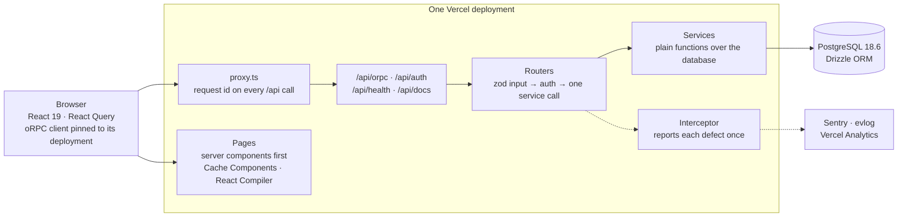
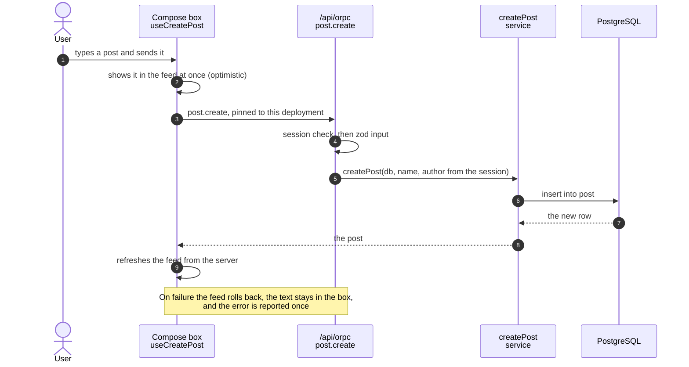

<div align="center">

# Feria

[](https://github.com/LRegalado1996/feria/actions/workflows/ci.yml)
[](package.json)
[](tsconfig.json)
[](docker-compose.base.yaml)
[](vitest.config.ts)

</div>

**Feria** (working name: LR Market) is a multi-store, bilingual mini e-commerce. Each store gets a public storefront made for a phone, and an admin panel where loading an article takes under a minute because Claude fills it in from the photos. The first store sells bubble guns and jewelry at a street Christmas fair from December 5, 2026, and online afterwards. What the product is, the decisions behind it and the roadmap are in [the project overview](docs/project/overview.md); the work is split into [tickets](docs/tickets/README.md).

Today the repository holds the base it is built on: one Next.js deployment on Vercel with the pages, a typed oRPC API, Better Auth email and password sign-in, and PostgreSQL through Drizzle ORM. A small posts demo still runs through every layer once (sign in, write a post, scroll the feed, delete your own post) and stays as the worked example until the catalog replaces it ([FER-012](docs/tickets/FER-012-remove-post-demo.md)).

The machinery around the demo is what the product keeps: guardrails that fail the build instead of relying on review, tests that must be able to fail, one place that reports errors, and a release pipeline that only ships what CI tested. Every rule was added because a real bug shipped without it, and [`AGENTS.md`](AGENTS.md) records why.

## Architecture



The boundaries that hold it together. Each one is written up in full, with the bug it prevents, in [`AGENTS.md`](AGENTS.md) and [`docs/agents/`](docs/agents):

- **Routers are thin; services own every query.** A procedure validates its input with zod, checks auth, and makes one service call. A service is a plain function that takes the database first and nothing request-scoped, so a script or a test can call it too. `pnpm check` fails if a router imports Drizzle.
- **An id from the client is a claim, never a grant.** The actor comes from the session. A write filters by owner and id together, so deleting someone else's post finds nothing and answers "not found".
- **The database is relational.** No JSON columns, 3NF at least. App tables use integer identity ids, timestamps carry their time zone, and every foreign key states `onDelete` and has an index. A paginated list sorts on a unique key, so pages never shuffle.
- **Errors are reported once, in the right place.** An expected failure (not signed in, not found) is a typed `ORPCError` and is not an incident. A Postgres constraint error becomes an answer the user can act on. Anything else is reported to Sentry once and answered with a curated 500 that never leaks the raw message.
- **Server first, URL as context.** Pages are server components unless they need interaction. Context lives in the URL, not in cookies, so every view is bookmarkable and safe in several tabs. Layouts never enforce auth: each page and each procedure does.
- **Releases never break open tabs.** Every oRPC call carries the deployment id of the page that made it, and Vercel's Skew Protection routes it to that build. A tab opened before a release keeps working ([`docs/agents/skew-protection.md`](docs/agents/skew-protection.md)).

## One request, end to end

Creating a post:



The page itself renders on the server: it fetches the first page of the feed and hands it to the browser with the HTML, behind a skeleton while it loads. If that fetch fails, the feed fetches again from the browser instead of showing an empty list.

## Getting started

You need Docker (Docker Desktop or OrbStack), the Node version in [`.nvmrc`](.nvmrc), and pnpm 11 (`corepack enable` installs the version pinned in `package.json`).

```bash
pnpm wt:provision   # installs dependencies and writes this worktree's .env; starts no containers
pnpm db:seed        # starts this worktree's Postgres, migrates it, adds a post, two stores (/lr-market, /tienda-demo) and a login: test@example.com / password123
pnpm dev            # next dev on this worktree's own port
pnpm wt:ports       # prints that port, the Postgres port and the app URL (it is not 3000)
```

Every git worktree gets its own database and ports, so several branches run side by side. Commands that need the database start it themselves, so there is no "start the stack" step to remember. `pnpm wt:pause` stops the containers and keeps the data; `pnpm wt:doctor` diagnoses a worktree that will not come up. The full lifecycle is in the [`worktree-env` skill](.agents/skills/worktree-env/SKILL.md).

## Everyday commands

| Command                                     | What it does                                                                                                                     |
| ------------------------------------------- | -------------------------------------------------------------------------------------------------------------------------------- |
| `pnpm exec vitest run path/to/file.test.ts` | one test file: the loop you will live in                                                                                         |
| `pnpm verify`                               | check + typecheck + unit tests through Turborepo; an unchanged tree replays in about a second                                    |
| `pnpm build`                                | `next build`; with `pnpm verify`, the definition of done                                                                         |
| `pnpm check` / `pnpm fix`                   | type-aware lint and format (Ultracite), knip, structure rules, ratchets, script self-tests                                       |
| `pnpm typecheck`                            | `tsrs --noEmit`, the Rust port of the TypeScript 7 compiler, for the app and the e2e suite; `next build` still checks with `tsc` |
| `pnpm test:unit:coverage`                   | unit tests with the coverage thresholds                                                                                          |
| `pnpm test:integration`                     | integration tests against this worktree's real Postgres                                                                          |
| `pnpm e2e` / `pnpm e2e:ui`                  | Playwright against this worktree's dev server, headless or interactive                                                           |
| `pnpm e2e:ci [spec]`                        | CI's e2e: its own database and a production build                                                                                |
| `pnpm verify:ci`                            | all of CI on this machine, on its own database; run it before pushing routing, auth or schema changes                            |
| `pnpm db:generate` → `pnpm db:migrate`      | after editing a schema file: read the generated SQL, commit it, apply it                                                         |
| `pnpm db:studio`                            | browse this worktree's database                                                                                                  |

Git hooks run the same tools: the pre-commit hook fixes and checks the staged files and scans them for secrets, and the pre-push hook runs `pnpm verify`.

## Testing

| Layer       | Where                                     | What it needs                                                                                   |
| ----------- | ----------------------------------------- | ----------------------------------------------------------------------------------------------- |
| Unit        | next to the code, `*.test.{ts,tsx}`       | nothing: Vitest with happy-dom; 100% of statements, functions and lines in `src/`               |
| Integration | next to the code, `*.integration.test.ts` | a real Postgres; each test worker gets its own cloned database                                  |
| End to end  | [`src/e2e/tests/`](src/e2e/tests)         | Playwright; CI and `pnpm e2e:ci` run the production build; each worker signs in as its own user |

Retries are zero in every suite, locally and in CI. A test that passes on the second try is a race that ships, so a failure fails the run and the retained trace explains it.

Coverage proves the code ran, not that it is right. A test must fail if the rule it names is deleted or inverted: assert the returned data and the side effect, check the arguments a spy received, and test both sides of every boundary. The rules and helpers (MSW, oRPC handlers, the mock database) are in [`docs/agents/testing.md`](docs/agents/testing.md); e2e specs follow [`src/e2e/AGENTS.md`](src/e2e/AGENTS.md).

## Repository map

```text
src/
  app/
    _components/        atoms · molecules · organisms (atomic design)
    api/orpc/           the oRPC handler
    api/auth/           Better Auth
    api/health/         database probe, optionally behind HEALTH_SECRET
    api/docs/           OpenAPI reference for the API
    [locale]/           every page, in Spanish (no prefix) and English (/en); the root layout
  server/
    api/routers/        thin routers, one per domain
    api/orpc/           procedure builders and request context
    api/interceptor.ts  classifies and reports every failure
    services/           every database query
    db/schema/          Drizzle tables, one file per domain; drizzle/ holds the migrations
    better-auth/        auth config
    test/               mock context and mock database for tests
  content/              interface text in Spanish and English, one file per area
  lib/
    hooks/              React Query hooks per domain
    i18n/               locales, localized paths, the dictionary provider
    schemas/            zod schemas per domain
    orpc/               clients for the browser and for server components
    errors/             reportError and error helpers
  e2e/                  Playwright specs, page objects, fixtures
  test/                 test setup, MSW handlers, mocks
  proxy.ts              routes pages by language; stamps a request id on every /api call
scripts/                worktree stack, CI parity, ratchets and guards; each one tests itself
docs/agents/            depth per area
```

## Environments and CI

| Branch          | Role                                                                                                                       |
| --------------- | -------------------------------------------------------------------------------------------------------------------------- |
| `qa`            | default base for pull requests; every push runs the full pipeline and deploys                                              |
| `main`          | production. `chore(release): promote qa to main` opens by itself when `qa` has something new; merge it with a merge commit |
| `hotfix/<slug>` | off `main`, only when `qa` cannot carry the fix; it owes a merge-back to `qa`                                              |

CI classifies the change, then runs Static Checks, Unit Tests, Integration Tests and Build in parallel, then E2E in the pinned Playwright container against that build, with Gitleaks alongside. `CI Success` is the merge gate into `qa`, next to `visual-proof`: a pull request that changes what people see must carry a screenshot or a recording in its description. `pr-description` holds every pull request to the same title format and the same sections. A release into `main` must pass `Promotion Verified`, which accepts only a tree that already passed CI on `qa`, so production runs exactly what was tested.

A pull request that touches only Markdown or `docs/` skips the runtime jobs, and a draft runs only the static checks. Vercel deploys `qa` and `main` through its Git integration. Previews are opt-in: add the `deploy:preview` label. Dependabot opens grouped updates once a week, after a cooldown, and merges patch and minor ones once CI passes; major versions wait for a person. The details are in [`docs/agents/ci.md`](docs/agents/ci.md).

## Where this base comes from

The repository was started from the Streaver Template, a snapshot of its `qa` branch at commit `8be9533e2e4faf331f5775e3d9ba1a9764459c00`. To pick up a later improvement, diff the upstream `qa` against that commit and port the change by hand; update the commit id here when you do.

What this project changed on the way in: the production branch is `main` (upstream calls it `production`), the promotion pull requests carry Conventional Commits titles, and visual proof is a required check instead of a courtesy.

## Project setup

What the repository needs outside the code. The hosting half is [FER-002](docs/tickets/FER-002-vercel-neon-blob.md) and [FER-003](docs/tickets/FER-003-ci-and-previews.md).

1. **GitHub settings:**
   - `qa` (the default branch) and `main` are protected: pull requests only, for admins too. `qa` requires `CI Success`, `visual-proof` and `pr-description`; `main` requires `Promotion Verified`, `visual-proof` and `pr-description`.
   - Default workflow permissions are read, and "Allow GitHub Actions to create and approve pull requests" is on: the promotion pull request is opened with the workflow's own token.
   - The labels `deploy:preview` and `size:XS` through `size:XXL` exist.
   - Preview deployments: the variables `VERCEL_PROJECT_ID` and `VERCEL_TEAM_ID`, and the environment `preview`, whose deployment branches admit only `qa`, holding the secret `VERCEL_PREVIEW_TOKEN` ([`docs/agents/ci.md`](docs/agents/ci.md) § Previews). Preview database cleanup: the secret `NEON_API_KEY` and the variable `NEON_PROJECT_ID`, the `feria-db-qa` project ([`docs/agents/database.md`](docs/agents/database.md) § Preview databases).
   - Not set up, by choice: a GitHub App (`BOT_APP_ID` variable, `BOT_APP_PRIVATE_KEY` secret) that would start a promotion PR's checks by itself. Without it, close and reopen each promotion PR to start them, and a Dependabot auto-merge starts no workflow: `qa` gets no push CI run and no promotion PR is opened for it until the next merge, or until Auto Promotion PR is run by hand on `qa` ([`docs/agents/ci.md`](docs/agents/ci.md) § Releases).
2. **Vercel project** `feria`, connected to this repository ([FER-002](docs/tickets/FER-002-vercel-neon-blob.md)). `main` is the production branch. The plan has no custom environments, so QA is the Preview environment's `qa` branch: its variables are scoped to that branch.

   | Environment | Branch | URL                                                       | Database (Neon) | Images (Blob)     |
   | ----------- | ------ | --------------------------------------------------------- | --------------- | ----------------- |
   | Production  | `main` | <https://feria-blond.vercel.app>                          | `feria-db`      | `feria-images`    |
   | QA          | `qa`   | <https://feria-git-qa-lucas-projects-628ba363.vercel.app> | `feria-db-qa`   | `feria-images-qa` |
   - The two databases are separate Neon projects, installed from the Vercel Marketplace: nothing written in QA can reach production. The production one is connected to Production only, the QA one to Preview only.
   - QA and every preview sit behind Vercel Authentication: open them signed in to Vercel, or with `vercel curl <url>/api/health`. Production is public.
   - The build migrates before it compiles (`buildCommand` in [`vercel.json`](vercel.json)). Check a deployment with `/api/health`, which answers `{"db":"ok"}`.
   - Node follows [`.nvmrc`](.nvmrc) (24.x). Keep the function region next to the databases (`regions` in `vercel.json`, `iad1`).
   - Still to turn on: Skew Protection (Settings → Advanced), Analytics and Speed Insights.

3. **Environment variables**, set in Vercel and listed with a comment each in [`.env.example`](.env.example):

   | Variable                                    | Production                | QA (`qa` branch)          | Previews           | Development (`vercel env pull`) |
   | ------------------------------------------- | ------------------------- | ------------------------- | ------------------ | ------------------------------- |
   | `PRODUCTION_DATABASE_URL`/`QA_DATABASE_URL` | `feria-db`, pooled        | `feria-db-qa`, pooled     | not set            | not set                         |
   | `MIGRATION_DATABASE_URL`                    | `feria-db`, direct        | `feria-db-qa`, direct     | not set            | not set                         |
   | `DATABASE_URL`                              | written by Neon, not read | written by Neon, not read | written by Neon    | the local Postgres              |
   | `NEON_PREVIEW_BRANCHES`                     | `1`                       | `1`                       | `1`                | not set                         |
   | `BETTER_AUTH_URL`                           | the production URL        | the QA URL                | derived per deploy | `http://localhost:3000`         |
   | `BETTER_AUTH_SECRET`                        | its own                   | shared with previews      | shared with QA     | its own                         |
   | `BLOB_READ_WRITE_TOKEN`                     | `feria-images`            | `feria-images-qa`         | `feria-images-qa`  | `feria-images-qa`               |
   | `NEXT_PUBLIC_SENTRY_DSN`                    | the `feria` project's     | the same DSN              | not set            | not set                         |
   | `SENTRY_ORG`, `SENTRY_PROJECT`              | `pepe-sas-uy`, `feria`    | the same                  | not set            | not set                         |
   | `SENTRY_AUTH_TOKEN`                         | one token                 | the same token            | set, unused        | not set                         |
   - Why production and QA read a dedicated database variable: [`docs/agents/database.md`](docs/agents/database.md) § Preview databases. Previews must never share a real database: the Neon integration gives each preview deployment its own branch of `feria-db-qa`, and a preview is deployed only for a PR labeled `deploy:preview`.
   - Sentry (project `feria` in the `pepe-sas-uy` organization) reports production as `production` and QA as `qa`. A pull request's preview has no DSN and never reports, so a closed branch cannot leave an issue open ([`docs/agents/observability.md`](docs/agents/observability.md) § Sentry). `SENTRY_AUTH_TOKEN` only uploads source maps during the build.
   - Vercel AI Gateway needs no variable on a deployment: it authenticates with the OIDC token Vercel injects. The project has a budget of USD 5 per month (`vercel ai-gateway budgets list`); at the limit the calls stop until the next month.
   - **Someone new:** `vercel link --yes --project feria`, `vercel env pull .env`, then `pnpm wt:provision`, which points `DATABASE_URL` and `BETTER_AUTH_URL` at this worktree. `.env` then holds the QA image store's token and a short-lived `VERCEL_OIDC_TOKEN` for the gateway; pull again when it expires.

4. **Optional services**, each inert until configured:
   - `HEALTH_SECRET` for the health probe.
   - Turborepo remote cache: `TURBO_TOKEN`, `TURBO_TEAM`, `TURBO_REMOTE_CACHE_SIGNATURE_KEY`.

## Documentation

| Read this                                | For                                                                                               |
| ---------------------------------------- | ------------------------------------------------------------------------------------------------- |
| [`docs/project/`](docs/project)          | what the product is: the overview, the decisions, the roadmap and the data model                  |
| [`docs/tickets/`](docs/tickets)          | the work, one file per ticket, with the index and how we work                                     |
| [`AGENTS.md`](AGENTS.md)                 | the rules every change follows, for people and AI agents alike. Read it first                     |
| [`design.md`](design.md)                 | UI rules: tokens, typography, layout, copy and accessibility. Read it before building UI          |
| [`docs/agents/`](docs/agents)            | depth per area: testing, database, security, observability, Next.js, languages, CI, agent tooling |
| [`src/e2e/AGENTS.md`](src/e2e/AGENTS.md) | how e2e specs, fixtures and page objects are written                                              |
| [`konsistent.json`](konsistent.json)     | the file-structure rules a linter cannot express, such as which files must sit together           |
| [`.agents/skills/`](.agents/skills)      | skills for agents: commits, PRs, the review loop, oRPC, the worktree stack, the running app       |

Documentation is part of the change: every pull request says `Documentation: updated` with the paths, or `no impact` and why.

## Security

- **Never commit `.env` or a secret.** Gitleaks checks each commit in the pre-commit hook, and CI scans the whole history. Never bypass a hook with `--no-verify`.
- **Fixtures use made-up data.** Fake secrets and passwords in tests start with `synthetic-`, the only values the scanner lets through, and only in test files.
- **Logs carry ids and enums only**, never a request body or free text. Unexpected errors reach the browser as a curated message with an event id, never the raw error.
- **Authorize every id.** Any id in input, a header or a cookie comes from the caller: filter by owner and id, and take the actor from the session ([`docs/agents/security.md`](docs/agents/security.md)).

---

`Refactor > Patch · Server > Client · Explicit > Implicit · Source types > Custom types · Relations > JSON · Tests mandatory · Errors observable · URL = context · No legacy`
